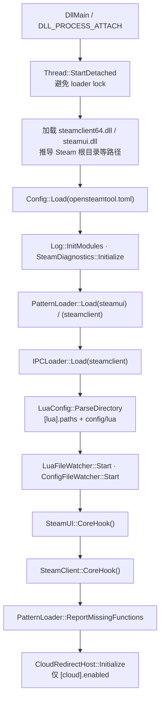
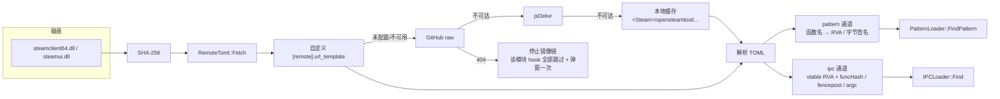
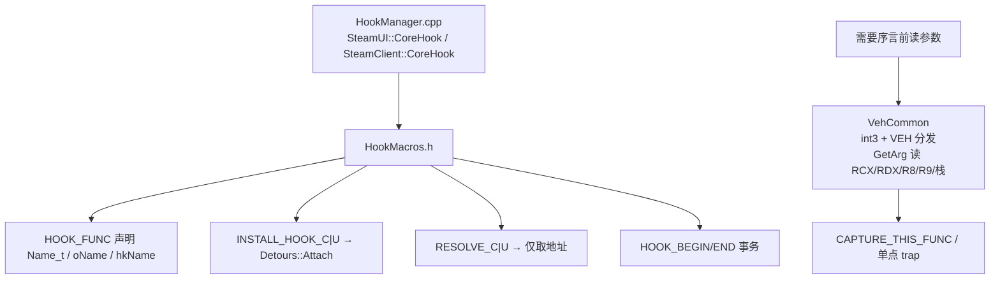
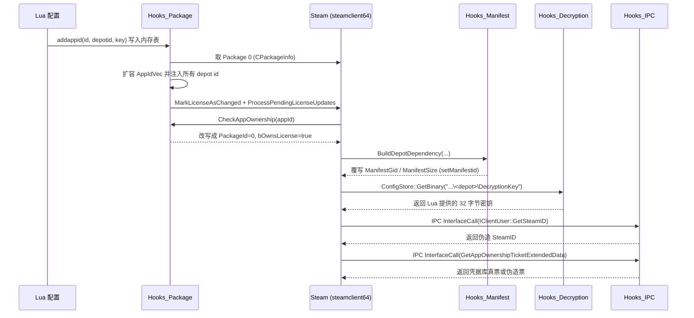
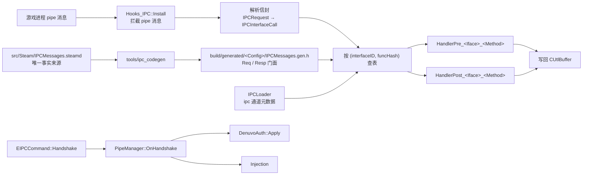
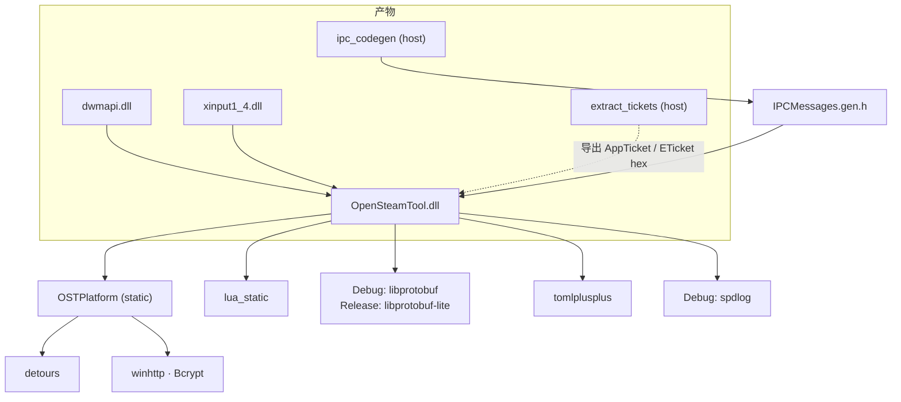

# OpenSteamTool 架构图

> Windows-only C++20 DLL，注入 Steam 进程，通过 hook `steamclient64.dll` / `steamui.dll` 伪造许可、清单、密钥与票据。

## 1. 分层结构

```
┌──────────────────────────────────────────────────────────────────────────┐
│  Steam 进程 (steam.exe)                                                   │
│                                                                          │
│  ┌────────────────┐   ┌────────────────┐                                 │
│  │  dwmapi.dll    │   │  xinput1_4.dll │   加载劫持层（极薄）             │
│  │  src/dwmapi/   │   │ src/xinput1_4/ │                                 │
│  └───────┬────────┘   └───────┬────────┘                                 │
│          └──────────┬─────────┘                                          │
│                     ▼                                                    │
│  ┌────────────────────────────────────────────────────────────────────┐  │
│  │  OpenSteamTool.dll                                                 │  │
│  │                                                                    │  │
│  │  dllmain.cpp ──► detached 工作线程 (InitThread)                    │  │
│  │                                                                    │  │
│  │  ┌──────────────────────────────────────────────────────────────┐  │  │
│  │  │ Hook 层  src/Hook/                                           │  │  │
│  │  │  HookManager · HookMacros (Detours) · VehCommon (int3)        │  │  │
│  │  │  IPC │ Manifest │ Decryption │ Package │ NetPacket           │  │  │
│  │  │  CallBack │ SteamUI │ Misc │ KeyValues(未启用)               │  │  │
│  │  └──────────────────────────────────────────────────────────────┘  │  │
│  │  ┌─────────────────────┐  ┌───────────────────────────────────┐   │  │
│  │  │ Pipe 子系统         │  │ 功能服务层                        │   │  │
│  │  │ PipeManager         │  │ SteamMetadata (Pattern/IPC/Manifest│   │  │
│  │  │ ProcessInspector    │  │   /Stats/Diagnostics/RemoteToml)  │   │  │
│  │  │ DenuvoAuth          │  │ Config · LuaConfig · Watchers      │   │  │
│  │  │ Injection           │  │ Tickets · CloudRedirect · Logging  │   │  │
│  │  └─────────────────────┘  └───────────────────────────────────┘   │  │
│  │  ┌──────────────────────────────────────────────────────────────┐  │  │
│  │  │ OSTPlatform (静态库)   Memory Detour Http Process Hash PE    │  │  │
│  │  │ Trap Thread DynamicLibrary DirectoryWatch CredentialStore …  │  │  │
│  │  │ 公开头文件不暴露 Win32 类型；实现全在 Windows/*.cpp           │  │  │
│  │  └──────────────────────────────────────────────────────────────┘  │  │
│  └────────────────────────────────────────────────────────────────────┘  │
│                                                                          │
│  steamclient64.dll            steamui.dll                                │
│  (被 hook 的主体)              (被 hook 的主体)                          │
└──────────────────────────────────────────────────────────────────────────┘

构建期依赖 / 代码生成
  tools/ipc_codegen  +  src/Steam/IPCMessages.steamd  →  IPCMessages.gen.h
  protoc             +  src/proto/steam_messages.proto →  steam_messages.pb.{h,cc}
  FetchContent 缓存  :  Lua 5.5 · protobuf 3.15.3 · spdlog · toml++ · Detours
```

## 2. 启动时序



## 3. 版本适配：元数据驱动



## 4. Hook 装配



## 5. 解锁数据流（addappid 之后发生了什么）



## 6. IPC 消息层



## 7. 目标与依赖关系


